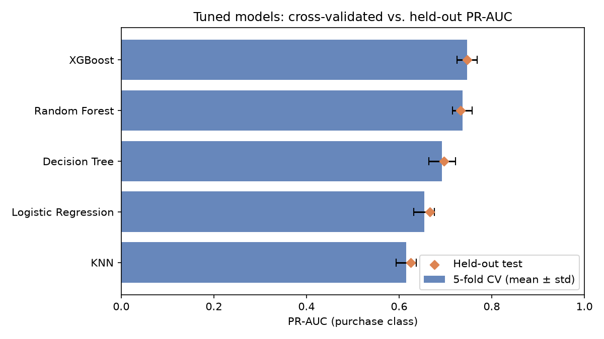
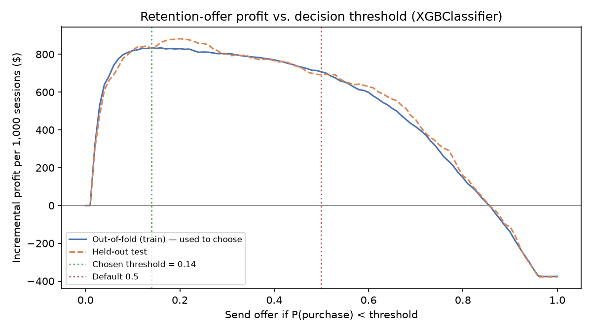

# Predicting Abandonment Tendency of Online Shoppers

## Project Overview  
Cart abandonment is a major challenge for e-commerce businesses, resulting in significant revenue loss. This project uses machine learning techniques to **predict whether an online shopper will abandon their cart**, helping businesses implement proactive strategies to reduce abandonment and increase conversions.

## Objective  
- Build predictive models to classify sessions as “purchase” or “no purchase”  
- Evaluate performance across models: **Logistic Regression, KNN, Decision Tree, Random Forest, and XGBoost**  
- Identify key behavioral features influencing cart abandonment  
- Recommend actionable strategies to enhance customer retention and ROI

## Setup & Usage
```bash
pip install -r requirements.txt
python main.py            # baseline: all 5 models, default hyperparameters, one train/test split
python main.py tune       # RandomizedSearchCV + 5-fold stratified CV for every model (~12 min on 8 cores)
python main.py profit     # cost-based decision threshold for the tuned best model (needs `tune` first)
python main.py all        # tune, then profit
```
The repo has two parallel pieces of work:
- **`notebooks/final_model.ipynb`**: the original course-project analysis, with per-model `GridSearchCV` tuning.
- **`src/` + `main.py`**: a runnable, leak-free version. Scaling, encoding and SMOTE all sit inside one `imblearn` `Pipeline`, so they are fit only on training folds and never see validation or test data. Tuning (`src/tuning.py`) and the threshold analysis (`src/profit.py`) build on that pipeline.

The notebook's tuning was done before the leakage fix, so its numbers aren't directly comparable with `src/`. The results below all come from `src/`.

## Motivation  
With rising competition in e-commerce, predicting user behavior is essential. By identifying high-risk abandonment users early, businesses can tailor engagement tactics like personalized offers or improved UX, ultimately increasing profitability.

## Dataset  
- **Source**: [Online Shoppers Purchasing Intention Dataset]  
- **Size**: 12,330 unique user sessions  
- **Features**: 18 total  
  - 10 numerical (e.g., Bounce Rate, Exit Rate, Page Value)  
  - 8 categorical (e.g., VisitorType, Month)  
- **Target Variable**: Revenue (True = Purchase, False = No Purchase)

## Preprocessing Steps  
- Checked for missing values (none found)  
- Applied **one-hot encoding** for categorical features  
- Used **StandardScaler** for numerical features  
- Addressed **class imbalance** (only 15.5% sessions were purchases) using oversampling

## Models Trained  
| Model               | Notes                                                                 |
|---------------------|-----------------------------------------------------------------------|
| Logistic Regression | Simple, interpretable baseline model                                  |
| K-Nearest Neighbors | Captures local data patterns but is sensitive to noise                |
| Decision Tree       | High interpretability, moderate performance                           |
| Random Forest       | Robust ensemble model, good feature importance insights               |
| **XGBoost**         | **Best performer**: highest cross-validated PR-AUC, ROC-AUC and F1 after tuning |

## Evaluation Metrics  
- **PR-AUC** (average precision, purchase class): the model-selection metric. It doesn't depend on a threshold, and unlike ROC-AUC it isn't inflated by the many easy no-purchase sessions.
- ROC-AUC, F1 for the purchase class, macro F1, precision, recall, Brier score
- Accuracy is not used: with 84.5% no-purchase sessions, a model that always predicts "no purchase" already scores 84.5%.

## Results: tuned models, 5-fold cross-validation
Every model was tuned with `RandomizedSearchCV` (25 candidates × 5 stratified folds) on the **training set only**. The best model was picked on CV PR-AUC. The held-out test set (20%, 2,441 sessions) was scored once at the end as an independent check.

| Model | CV PR-AUC | Test PR-AUC | CV ROC-AUC | Test ROC-AUC | CV F1 (buyers) | Test F1 (buyers) |
|---|---|---|---|---|---|---|
| **XGBoost** | **0.747 ± 0.022** | **0.747** | **0.933 ± 0.005** | **0.935** | **0.689 ± 0.023** | **0.687** |
| Random Forest | 0.737 ± 0.021 | 0.733 | 0.931 ± 0.004 | 0.933 | 0.674 ± 0.014 | 0.687 |
| Decision Tree | 0.693 ± 0.029 | 0.696 | 0.914 ± 0.009 | 0.920 | 0.646 ± 0.020 | 0.653 |
| Logistic Regression | 0.654 ± 0.022 | 0.666 | 0.902 ± 0.010 | 0.911 | 0.624 ± 0.022 | 0.626 |
| KNN | 0.616 ± 0.022 | 0.625 | 0.872 ± 0.011 | 0.886 | 0.345 ± 0.034 | 0.322 |



- Test scores fall inside the CV mean ± std for every model, so the estimates are stable and the models aren't overfit to one split.
- XGBoost and Random Forest are within one standard deviation of each other. XGBoost's lead is real but small.
- Full metrics are in [`reports/cv_model_comparison.csv`](reports/cv_model_comparison.csv) and the chosen hyperparameters in [`reports/tuned_params.json`](reports/tuned_params.json).

## Results: choosing the decision threshold by profit
A classifier's default 0.5 cutoff ignores the fact that the two kinds of error cost different amounts. Here the model drives a **retention offer**: a session gets a discount offer when P(purchase) < threshold.

**Assumptions** (illustrative, since the dataset has no prices; all set in [`src/config.py`](src/config.py)):

| Parameter | Value |
|---|---|
| Average order value × gross margin | $100 × 30% = $30 |
| Discount per redeemed offer | $10 |
| Cost to serve one offer | $0.50 |
| Share of targeted would-be abandoners who then buy | 10% |

From these assumptions:
- Reaching a would-be abandoner is worth +$1.50 on average: 10% of them buy, earning $30 − $10, minus the $0.50 cost of every offer.
- Offering a discount to someone who would have bought anyway costs −$10.50.

The threshold is chosen on **out-of-fold predictions on the training set**, never on the test set, and then applied once to the test set:

| Strategy (test set) | Profit per 1,000 sessions | Abandoners reached | Buyers given an unneeded discount |
|---|---|---|---|
| **Profit-optimal threshold (0.14)** | **$830** | 77% | 9% |
| Default threshold (0.5) | $692 | 94% | 30% |
| Offer to everyone | −$378 | 100% | 100% |
| Offer to nobody | $0 | 0% | 0% |
| Perfect model (upper bound) | $1,265 | 100% | 0% |



- **Moving the threshold from 0.5 to 0.14 adds about 20% profit** ($830 vs. $692 per 1,000 sessions) with the same model. It gives up a few marginal abandoners to stop handing discounts to 30% of buyers.
- The profit curve is flat between about 0.10 and 0.30, so the gain doesn't depend on hitting one exact cutoff. The out-of-fold curve and the test curve agree closely.
- The model captures about 66% of the profit a perfect model would make.
- **Sensitivity:** the best threshold depends on how persuasive the offer is. At a 5% recovery rate the best threshold is 0.07, and using 0.5 would *lose* money (−$99 vs. +$216). At 20% it rises to 0.40. The threshold should be re-chosen whenever the campaign economics change. Full output is in [`reports/profit_threshold.json`](reports/profit_threshold.json).
- With calibrated probabilities, the theoretical break-even would be P(purchase) < 1.5 / (1.5 + 10.5) = 0.125. SMOTE distorts predicted probabilities, so the threshold is found by an empirical sweep rather than taken from that formula. It lands close (0.14).

## Key Findings  
- **XGBoost had the best cross-validated scores** (PR-AUC 0.747 ± 0.022), with Random Forest a close second  
- **The decision threshold matters as much as the model**: a cost-based threshold beat the default 0.5 by about 20% in simulated profit  
- Important predictors:  
  - Product-Related Duration  
  - Page Value  
  - Special Days (holidays, events)  

## Business Implications  
- **Marketing Optimization**: Focus resources on users predicted to complete purchases  
- **Personalization**: Tailor experience based on session behavior  
- **Revenue Boost**: Reduce abandoned carts → increased conversions

## Challenges  
- Imbalanced dataset required careful balancing of precision and recall  
- Computational cost of tuning ensemble models (especially XGBoost)  
- Session-only data limited long-term behavioral analysis

## Future Work  
- Integrate user- and product-level features (e.g., loyalty, categories, discounts)  
- Explore deep learning models (CNNs, RNNs)  
- Deploy model in real-time scoring engine  
- Conduct A/B testing to measure business impact
- Calibrate probabilities (e.g. `CalibratedClassifierCV`) so scores can be read as real purchase likelihoods
- Replace the illustrative cost assumptions with real campaign data, ideally recovery rates measured in an A/B test
- Use nested cross-validation for a fully unbiased performance estimate of the tuning procedure

## Final Recommendation  
Use the tuned **XGBoost** pipeline to score sessions. Send retention offers only below a **profit-based threshold** (0.14 under the assumptions above), not the default 0.5, and re-choose that threshold whenever discount size or campaign effectiveness changes.
