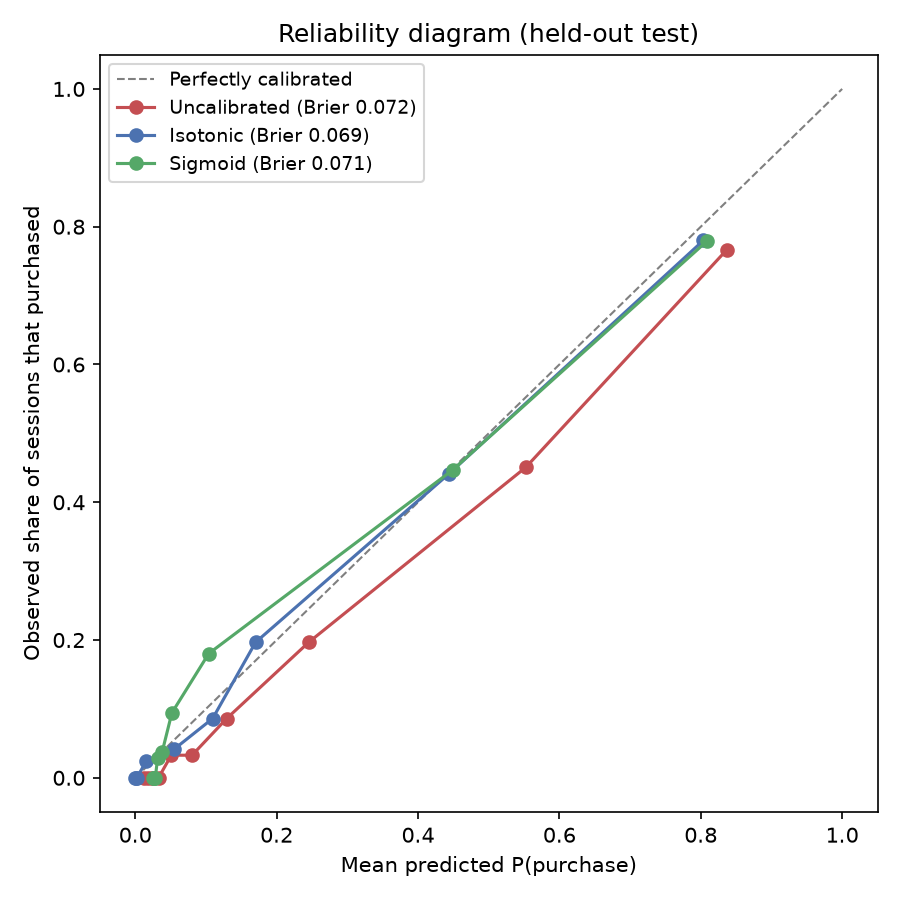
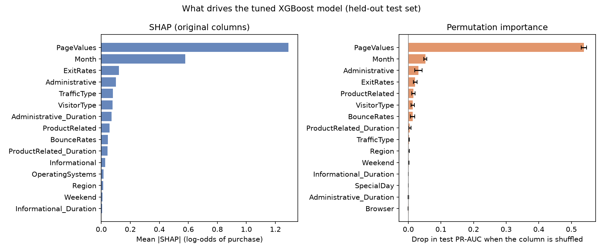
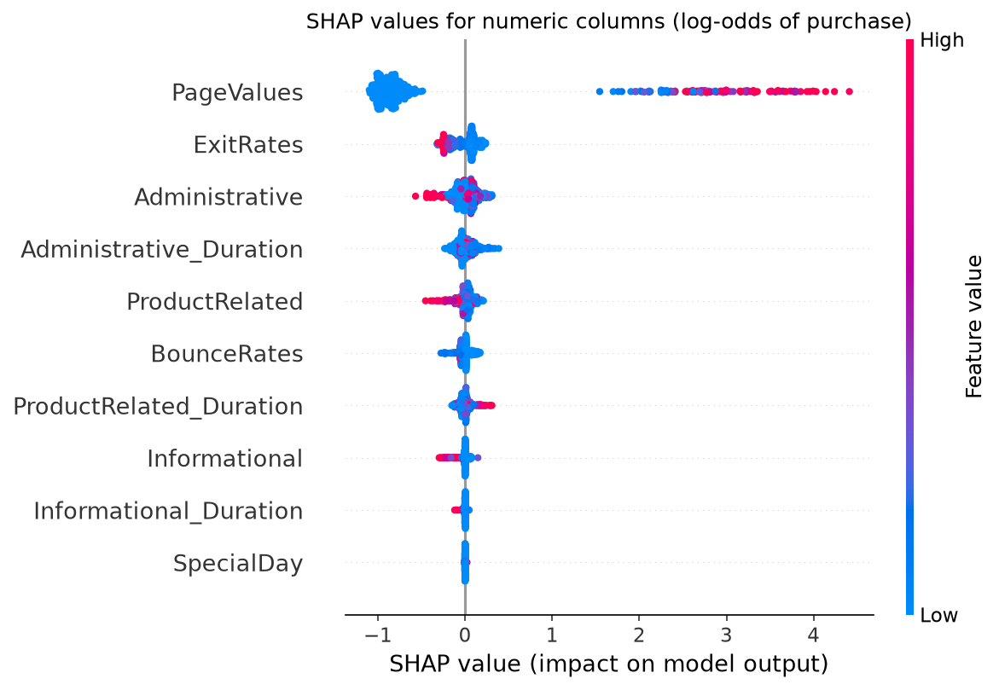

# Predicting Abandonment Tendency of Online Shoppers

## Project Overview  
Shopping abandonment is a major source of lost revenue for e-commerce businesses. This project predicts **the probability that a browsing session ends in a purchase**. Sessions with a low predicted P(purchase) are the ones at risk of abandonment, and those get a retention offer. The decision threshold for sending an offer is set by expected profit, not by the default 0.5.

> **Framing used throughout:** the positive class is `Revenue = True` (purchase). "Abandonment" means a session that ends *without* a purchase, i.e. low P(purchase). All metrics (PR-AUC, F1, precision, recall) refer to the purchase class unless stated otherwise.

## About this project
This is an independent extension of a group project from **ISM 6251 Machine Learning** (University of South Florida, Fall 2024). The original group analysis is in [`notebooks/final_model.ipynb`](notebooks/final_model.ipynb).

Everything in `src/`, `main.py` and `reports/` is my independent work:
- leak-free preprocessing pipeline
- cross-validated tuning
- profit-based threshold selection
- probability calibration
- SHAP explainability

Reference paper: Rausch, T. M., Derra, N. D., & Wolf, L. (2022). *Predicting online shopping cart abandonment with machine learning approaches.* International Journal of Market Research, 64(1), 89–112. https://doi.org/10.1177/1470785320972526

## Objective  
- Predict P(purchase) for each session, so that sessions likely to be abandoned can be identified
- Compare **Logistic Regression, KNN, Decision Tree, Random Forest and XGBoost** with tuned, cross-validated scores
- Identify which session behaviours drive the prediction, checked with two independent methods
- Turn predictions into a decision (who gets a retention offer) that maximises expected profit

## Setup & Usage
```bash
pip install -r requirements.txt
python main.py            # baseline: all 5 models, default hyperparameters, one train/test split
python main.py tune       # RandomizedSearchCV + 5-fold stratified CV for every model (~12 min on 8 cores)
python main.py profit     # cost-based decision threshold for the tuned best model (needs `tune` first)
python main.py explain    # SHAP + permutation importance for the tuned model (~7 min)
python main.py calibrate  # probability calibration and its effect on the threshold (needs `profit` first)
python main.py all        # tune, profit, explain, calibrate (~22 min)
```
The repo has two parallel pieces of work:
- **`notebooks/final_model.ipynb`**: the original course-project analysis, with per-model `GridSearchCV` tuning.
- **`src/` + `main.py`**: a runnable, leak-free version. Scaling, encoding and SMOTE all sit inside one `imblearn` `Pipeline`, so they are fit only on training folds and never see validation or test data. Tuning (`src/tuning.py`), the threshold analysis (`src/profit.py`), explainability (`src/explain.py`) and calibration (`src/calibration.py`) all build on that pipeline.

The notebook's tuning was done before the leakage fix, so its numbers aren't directly comparable with `src/`. The results below all come from `src/`.

## Motivation  
With rising competition in e-commerce, predicting user behaviour is essential. Identifying sessions at high risk of abandonment early lets a business target offers or UX fixes where they pay off. It also avoids handing discounts to customers who were going to buy anyway.

## Dataset  
- **Source**: [Online Shoppers Purchasing Intention Dataset](https://www.kaggle.com/datasets/imakash3011/online-shoppers-purchasing-intention-dataset) (Kaggle mirror of the UCI dataset)
- **Size**: 12,330 sessions, of which 125 exact duplicate rows are dropped, leaving 12,205
- **Features**: 17
  - 10 numerical (e.g. PageValues, ExitRates, BounceRates, ProductRelated_Duration, SpecialDay)
  - 7 categorical (Month, VisitorType, TrafficType, Region, Browser, OperatingSystems, Weekend)
- **Target**: `Revenue` (True = purchase, 15.5% of sessions; False = no purchase / abandoned)

## Preprocessing Steps  
- Checked for missing values (none found)  
- Applied **one-hot encoding** for categorical features  
- Used **StandardScaler** for numerical features  
- Addressed **class imbalance** (only 15.5% sessions were purchases) using oversampling

## Models Trained  
| Model               | Notes                                                                 |
|---------------------|-----------------------------------------------------------------------|
| Logistic Regression | Simple, interpretable baseline model                                  |
| K-Nearest Neighbors | Captures local data patterns but is sensitive to noise                |
| Decision Tree       | High interpretability, moderate performance                           |
| Random Forest       | Robust ensemble model, good feature importance insights               |
| **XGBoost**         | **Best performer**: highest cross-validated PR-AUC, ROC-AUC and F1 after tuning |

## Evaluation Metrics  
- **PR-AUC** (average precision, purchase class): the model-selection metric. It doesn't depend on a threshold, and unlike ROC-AUC it isn't inflated by the many easy no-purchase sessions.
- ROC-AUC, F1 for the purchase class, macro F1, precision, recall, Brier score
- Accuracy is not used: with 84.5% no-purchase sessions, a model that always predicts "no purchase" already scores 84.5%.

## Results: tuned models, 5-fold cross-validation
Every model was tuned with `RandomizedSearchCV` (25 candidates × 5 stratified folds) on the **training set only**. The best model was picked on CV PR-AUC. The held-out test set (20%, 2,441 sessions) was scored once at the end as an independent check.

| Model | CV PR-AUC | Test PR-AUC | CV ROC-AUC | Test ROC-AUC | CV F1 (buyers) | Test F1 (buyers) |
|---|---|---|---|---|---|---|
| **XGBoost** | **0.747 ± 0.022** | **0.747** | **0.933 ± 0.005** | **0.935** | **0.689 ± 0.023** | **0.687** |
| Random Forest | 0.737 ± 0.021 | 0.733 | 0.931 ± 0.004 | 0.933 | 0.674 ± 0.014 | 0.687 |
| Decision Tree | 0.693 ± 0.029 | 0.696 | 0.914 ± 0.009 | 0.920 | 0.646 ± 0.020 | 0.653 |
| Logistic Regression | 0.654 ± 0.022 | 0.666 | 0.902 ± 0.010 | 0.911 | 0.624 ± 0.022 | 0.626 |
| KNN | 0.616 ± 0.022 | 0.625 | 0.872 ± 0.011 | 0.886 | 0.345 ± 0.034 | 0.322 |


- Test scores fall inside the CV mean ± std for every model, so the estimates are stable and the models aren't overfit to one split.
- XGBoost and Random Forest are within one standard deviation of each other. XGBoost's lead is real but small.
- Full metrics are in [`reports/cv_model_comparison.csv`](reports/cv_model_comparison.csv) and the chosen hyperparameters in [`reports/tuned_params.json`](reports/tuned_params.json).

## Results: choosing the decision threshold by profit
A classifier's default 0.5 cutoff ignores the fact that the two kinds of error cost different amounts. Here the model drives a **retention offer**: a session gets a discount offer when P(purchase) < threshold.

**Assumptions** (illustrative, since the dataset has no prices; all set in [`src/config.py`](src/config.py)):

| Parameter | Value |
|---|---|
| Average order value × gross margin | $100 × 30% = $30 |
| Discount per redeemed offer | $10 |
| Cost to serve one offer | $0.50 |
| Share of targeted would-be abandoners who then buy | 10% |

From these assumptions:
- Reaching a would-be abandoner is worth +$1.50 on average: 10% of them buy, earning $30 − $10, minus the $0.50 cost of every offer.
- Offering a discount to someone who would have bought anyway costs −$10.50.

The threshold is chosen on **out-of-fold predictions on the training set**, never on the test set, and then applied once to the test set:

| Strategy (test set) | Profit per 1,000 sessions | Abandoners reached | Buyers given an unneeded discount |
|---|---|---|---|
| **Profit-optimal threshold (0.14)** | **$830** | 77% | 9% |
| Default threshold (0.5) | $692 | 94% | 30% |
| Offer to everyone | −$378 | 100% | 100% |
| Offer to nobody | $0 | 0% | 0% |
| Perfect model (upper bound) | $1,265 | 100% | 0% |


- **Moving the threshold from 0.5 to 0.14 adds about 20% profit** ($830 vs. $692 per 1,000 sessions) with the same model. It gives up a few marginal abandoners to stop handing discounts to 30% of buyers.
- The profit curve is flat between about 0.10 and 0.30, so the gain doesn't depend on hitting one exact cutoff. The out-of-fold curve and the test curve agree closely.
- The model captures about 66% of the profit a perfect model would make.
- **Sensitivity:** the best threshold depends on how persuasive the offer is. At a 5% recovery rate the best threshold is 0.07, and using 0.5 would *lose* money (−$99 vs. +$216). At 20% it rises to 0.40. The threshold should be re-chosen whenever the campaign economics change. Full output is in [`reports/profit_threshold.json`](reports/profit_threshold.json).
- With calibrated probabilities, the theoretical break-even would be P(purchase) < 1.5 / (1.5 + 10.5) = 0.125. The empirical sweep lands close to it (0.14). The next section shows that calibration lets you use the formula directly.

## Results: probability calibration
SMOTE trains the model on a 50/50 class mix, so its raw scores overstate P(purchase) on real traffic, where only 15.6% of sessions buy.

[`CalibratedClassifierCV`](src/calibration.py) learns a mapping from raw scores to observed purchase rates on held-out folds of the training set. Isotonic calibration was chosen in advance, since there are about 10k training sessions; sigmoid (Platt) is shown for comparison. The test set is used only for evaluation.

| Test set | Brier ↓ | Log loss ↓ | PR-AUC | Mean predicted P(purchase) |
|---|---|---|---|---|
| Uncalibrated | 0.0717 | 0.2381 | 0.747 | 0.198 |
| **Isotonic** | **0.0694** | **0.2236** | 0.747 | **0.159** |
| Sigmoid | 0.0706 | 0.2377 | 0.747 | 0.159 |
| *Actual purchase rate* | | | | *0.156* |



- Uncalibrated, the model says 19.8% of sessions will buy, against 15.6% in reality. After isotonic calibration it says 15.9%, so a score of 0.3 now really means about a 30% chance of purchase.
- PR-AUC is unchanged. Calibration doesn't change *which* sessions rank higher, only what the numbers mean.
- **The payoff for the decision:** with calibrated probabilities the threshold comes straight from the cost assumptions (0.125), with no threshold search. On the test set that earns **$873** per 1,000 sessions, vs. **$830** for the uncalibrated model with its searched threshold (0.14). The two are close; the real advantage is that when costs change, the new threshold is just the formula, with no re-tuning. See [`reports/calibration.json`](reports/calibration.json).

## Results: what drives the predictions
Two independent methods, both run on the held-out test set:
- **SHAP**, computed on the 17 original columns against a background of real training sessions. Run on 500 test sessions.
- **Permutation importance**: the drop in test PR-AUC when one column is shuffled, averaged over 10 repeats and all test sessions.



| Rank | SHAP (mean \|SHAP\|, log-odds) | Permutation (PR-AUC drop) |
|---|---|---|
| 1 | **PageValues** 1.29 | **PageValues** 0.539 |
| 2 | **Month** 0.58 | **Month** 0.052 |
| 3 | ExitRates 0.12 | Administrative 0.031 |
| 4 | Administrative 0.10 | ExitRates 0.021 |



- **PageValues dominates.** It is the average value of the pages a visitor saw before reaching a transaction page, and it is zero for 78% of sessions. Those sessions buy 3.8% of the time; sessions with PageValues > 0 buy 57% of the time. Shuffling PageValues alone cuts PR-AUC from 0.747 to about 0.21.
- **Month is second.** November raises the odds most (mean SHAP +1.05) and May lowers them most (−0.75). This matches the raw data: November has the highest purchase rate (25%).
- **A higher ExitRate lowers the odds of purchase.** The correlation between a session's ExitRate and its SHAP value is −0.78.
- **SpecialDay (proximity to holidays) has almost no effect.** It ranks last of 17 by SHAP and 13th by permutation importance.

**Method note.** SHAP was computed on the original columns, not with `TreeExplainer` on the one-hot features, because the faster per-feature approach gave wrong answers here, checked against the model's own predictions:
1. It ranked Region #1, yet shuffling Region barely changes PR-AUC (0.002). The SMOTE-generated training points have impossible one-hot values (e.g. Region_3 = 0.4), and these distort `TreeExplainer`'s default mode.
2. It said November *lowers* purchase odds. Yet setting every test session's month to November gives the highest average prediction of any month.

The reasoning is documented in [`src/explain.py`](src/explain.py).

## Key Findings  
- **XGBoost had the best cross-validated scores** (PR-AUC 0.747 ± 0.022), with Random Forest a close second.
- **The decision threshold matters as much as the model choice.** A cost-based threshold beat the default 0.5 by about 20% in simulated profit.
- **Calibration makes the scores mean what they say.** Mean predicted P(purchase) went from 19.8% to 15.9% against 15.6% actual, so the threshold can be set directly from business costs.
- **What drives purchases:** PageValues by a wide margin, then Month (November high, May low), then ExitRates and Administrative page visits. Both SHAP and permutation importance agree. Contrary to an earlier version of this README, SpecialDay and ProductRelated_Duration are *not* among the top predictors.

## Business Implications  
- **Target offers at the right sessions.** Send retention offers only to sessions below the profit-based threshold. Sending them to everyone loses money (−$378 per 1,000 sessions) because most of the cost goes on buyers who didn't need a discount.
- **PageValues is the early-warning signal.** A session that hasn't reached any valuable page is very unlikely to convert, so that is where UX nudges or offers have room to help.
- **Plan for seasonality.** Expect higher conversion in November, and set budgets and thresholds for each season.

## Challenges  
- Imbalanced dataset required careful balancing of precision and recall  
- Computational cost of tuning ensemble models (especially XGBoost)  
- Session-only data limited long-term behavioral analysis

## Future Work  
- Integrate user- and product-level features (e.g., loyalty, categories, discounts)  
- Use `SMOTENC` (SMOTE for mixed numeric and categorical data), or class weights, instead of plain SMOTE on one-hot columns. This avoids synthetic sessions with impossible category values (see the explainability method note), and the tuning should then be re-run.
- Try a small feed-forward neural network (MLP) as an additional model family
- Deploy the model in a real-time scoring engine  
- Replace the illustrative cost assumptions with real campaign data, ideally recovery rates measured in an A/B test
- Use nested cross-validation for a fully unbiased performance estimate of the tuning procedure

## Final Recommendation  
Use the tuned, **isotonic-calibrated XGBoost** pipeline to score sessions. Send retention offers only when calibrated P(purchase) is below the break-even threshold implied by the campaign economics (0.125 under the assumptions above), not the default 0.5. When the discount size or the recovery rate changes, recompute the threshold with the same formula.
